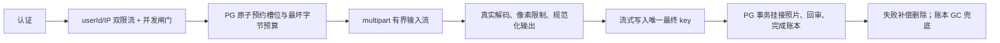

# 全仓安全审查修复方案（待确认）

> 日期：2026-07-20
>
> 状态：**方案草案，等待产品所有者确认；本文不代表已经实施**
>
> 上游审查：`docs/reviews/2026-07-20-full-repository-security-review.md`
>
> 基线：`main` / `3c9e716`
>
> 复核校准（2026-07-21，比对代码库与当前依赖后）：持久化上传预约重新列为关闭 P0 的必要条件，以满足读流前原子占额度；对象 staging+复制则明确删除，改为唯一最终 key + 补偿删除 + 账本 GC。上传双重限流改用 `createRateLimit()` 复合检查，避免 `@fastify/rate-limit@11.1.0` 多 handler 只执行第一个；全局桶改为稳定 IP。另补昵称审核边界、逐对象备份清单、会话迁移的 iOS 成本、multipart 上限与 sharp 内存预算。已核实 iOS 上传出口统一为 JPEG（`apps/ios/Zhixing/Core/FootprintStore.swift:92-105`），node:22-slim 为 glibc，sharp 对 JPEG/PNG 开箱即用。

## 1. 结论

建议分五批处理，顺序不按“改起来是否简单”，而按能否真正关闭风险：

1. **P0 临时阻断**：上传专用 userId/IP 双重限流、单用户/全局并发闸门、生产资源上限；同时补上生产 dev-auth 启动拒绝。
2. **P0 根治**：持久化上传预约、数据库行锁配额、有界流式图片处理、对象补偿与账本驱动 GC。
3. **P1 审核一致性**：足迹内容 revision + 条件更新，并冻结登录时修改存量昵称；管理员只能批准自己看到的公开内容。
4. **P1 可恢复性**：照片异地备份、备份清单、隔离恢复演练；完成前不承诺真实照片可恢复。
5. **纵深加固**：CORS、Admin 会话/CSP、用户会话撤销、本地端口绑定与监控。

其中第 1 批只能降低可利用性，**不能把 P0 标记为已解决**。只有第 2 批达到 §9 验收标准后才能关闭 P0：在读取文件流前持久化预约照片槽位和最坏字节预算；上传过程中严格限制输入、像素和输出；对象写入唯一最终 key；提交失败执行补偿删除，补偿失败由账本 GC 在明确宽限期内清理。第 1～4 批应作为扩大真实用户内测前的发布门槛。

## 2. 核心取舍

### 2.1 推荐保留现有上传 API，改为有界流式处理

本轮不建议直接切成“iOS 预签名直传对象存储”：当前是单 API、单对象存储、单人维护，直传会额外引入初始化、预签名、完成确认、客户端断点状态和旧版本兼容等协议复杂度；服务端仍需重新读取对象做真实图片解码，无法省掉安全处理。

推荐继续使用现有 `POST /footprints/:id/photos`，但内部改为：

这样不要求 iOS 强制升级，且能同时解决整文件内存缓冲、数量竞态、累计配额、伪造 MIME、孤儿对象和公开内容回审问题。最终 key 使用不可预测 UUID 且永不覆盖，因此不需要先写 staging 再复制；数据库尚未挂接的对象由 `PhotoUpload` 状态解释并由 GC 清理。未来出现多实例或上传流量明显增长时，再把 C～F 替换为预签名直传，数据库账本和后续确认流程可以继续复用。

### 2.2 配额必须以数据库预约账本为权威，不能只用内存计数或提交期统计

- 内存限流/信号量只负责保护单个 API 进程，重启或扩容后不具备全局一致性。
- 单足迹数量、账号累计数量/字节、当日用量和活动预约必须在 PostgreSQL 事务中判断，并在读取 multipart 文件流前写入持久化预约。
- 事务固定按 `User → Footprint` 顺序 `SELECT ... FOR UPDATE`，所有上传、删图、删足迹路径遵守同一锁序，避免竞态和死锁。
- 不在上传网络请求期间长期持有数据库事务：请求开始时用短事务写 `RESERVED`，流式上传结束后再用短事务确认 `COMPLETED`；网络传输期间只持有账本记录，不持有数据库行锁。
- 预约按最坏预算记账：每日输入额度先占 8 MiB、累计存储额度先占 6 MiB；完成后分别换成实际输入/存储字节。并发请求因此不能同时透支剩余额度。失败请求至少保留本次尝试和实际已消费输入字节，不能把昂贵失败全部返还给攻击者。

## 3. 建议初始阈值

以下是内测期的保守默认值，全部集中在服务端配置和命名常量中；单足迹上限仍与 iOS `ZXLimit.footprintPhotos` 保持 12。账号累计配额应支持管理员按用户覆盖，避免真实用户被统一阈值误伤；“每日”统一定义为滚动 24 小时窗口，避免服务器时区或自然日边界产生双倍突发额度。

| 护栏 | 建议初值 | 目的 |
| --- | ---: | --- |
| 单文件输入 | 8 MiB | 当前 iOS 已压成 JPEG；降低单请求成本 |
| 解码像素 | 40 MP | 拒绝解压炸弹 |
| 归一化长边 | 4096 px | 限制处理与存储成本，保留看图质量 |
| 归一化输出 | JPEG 85，最大 6 MiB | 去 EXIF、统一格式、限制最终对象大小 |
| 单足迹照片 | 12 | 保持现有产品口径 |
| 单用户同时上传 | 2 | 防单账号并发占满处理器 |
| 单 API 实例同时处理 | 4 | 为 2C4G 起步机型保留内存余量 |
| 单用户上传频率 | 30 次/分钟 | 限制快速小文件滥用 |
| 单 IP 上传频率 | 120 次/分钟 | 防批量账号绕过；不替代 userId 限制 |
| 单用户每日 | 500 张或 2 GiB，先到者为准 | 控制持续灌入 |
| 单用户累计 | 3000 张或 5 GiB，先到者为准 | 内测期反滥用；允许人工扩容 |
| 预约有效期 | 15 分钟 | 客户端中断后由 GC 释放无对象预约；有残留对象时先清对象再释放存储额度 |

上线前应以真实 iPhone 最大照片样本压测一次，再决定 8 MiB、4096 px 和并发 4 是否需要调整。阈值变化不得要求改数据库或重新发 iOS 版本。落地时须把 `apps/api/src/app.ts` 的 multipart `fileSize`（现 15 MiB）同步下调到 8 MiB 对齐，或让字节计数器先于 multipart 上限触发，两处数字必须一致。

## 4. 第一批：P0 临时阻断

### 4.1 上传专用限流

- 默认全局 300/min 继续在 `onRequest` 执行，但 `keyGenerator` 改为稳定的 `req.ip`；此阶段 `requireUser` 尚未运行，不能声称可取得 `req.userId`，也不能继续使用 `authorization ?? ip`。认证、搜索等已有更严格路由级 IP 桶的接口可继续用其较低阈值替代默认 300/min。生产 `TRUST_PROXY=1` 的前提仍是 API 只接受可信 Caddy 转发，避免伪造 `X-Forwarded-For`。
- 照片路由不使用单个 `config.rateLimit` 覆盖全局限制，也不串联多个 `app.rateLimit()` preHandler。当前 `@fastify/rate-limit@11.1.0` 的 route config 只生成一个路由 limiter，多个 handler 又共享 `rateLimitRan` 标记，第二个起会跳过。
- 用两个独立的 `app.createRateLimit()` 检查组成 `photoUploadRateLimit`：`upload:user:<req.userId>` 30/min、`upload:ip:<req.ip>` 120/min。路由 preHandler 明确为 `[requireUser, photoUploadRateLimit]`；复合检查任一超限即返回 429。key 必须带不同前缀，避免 userId 与 IP 文本偶然碰撞。
- 全局 IP 桶、上传 userId 桶和上传 IP 桶三者同时生效；不得以路由自定义配置替换其中任何一个。
- 429 统一为 `{ error: "rate_limit_exceeded" }` 并带 `Retry-After`。
- 回归测试至少覆盖：同账号换新 JWT 仍命中同一 userId 桶；同 IP 多账号命中 IP 桶；伪造不同 Authorization 头不能绕过全局 IP 桶；两个上传专用桶各自都能单独触发 429。

### 4.2 并发与宿主保护

- 路由进入文件流之前获取“单用户 2、单实例 4”的闸门；无槽位立即返回 429/503，不读取完整文件。
- `compose.prod.yml` 为 API 加内存、CPU、PID 和日志轮转上限；OOM 最多重启 API，不能把 PostgreSQL 一起拖死。内存上限须把 sharp 的原生/堆外工作集算进去（不能只按 V8 堆预算），否则会在解码中途被 cgroup OOM-kill；§9.2 的 RSS 压测正好用来核定这条预算。
- MinIO 与 PostgreSQL 长期不应共享无边界的同一磁盘故障域。最低要求是 MinIO 独立受限卷并配磁盘水位告警；更推荐迁到有容量/版本管理的 S3 兼容托管存储。
- 水位达到告警线时先停止新上传，不停止已有照片读取；达到硬线时返回 `503 storage_capacity_reached`。

### 4.3 生产启动守卫

- 把 `findWeakSecrets` 扩展为完整的生产配置检查结果；`config.devAuth === true` 时拒绝启动。
- `compose.prod.yml` 显式注入 `ZHIXING_DEV_AUTH: ${ZHIXING_DEV_AUTH:-0}`，避免配置状态隐含。
- 增加纯函数测试：production + dev auth 开启必报错，非 production 不影响本地开发。

## 5. 第二批：P0 根治

### 5.1 数据模型

> 定位（2026-07-21 校准）：本节的持久化预约账本是关闭 P0 的必要条件。它同时承担读流前原子占额度、失败输入计量、对象生命周期解释和 GC 安全边界；不能用提交期统计或进程内计数替代。

新增持久化上传账本 `PhotoUpload`（名称可在实施时微调）：

- `id / userId / footprintId? / status`
- `reservedInputBytes / reservedStoredBytes / inputBytes? / storedBytes?`
- `objectKey? / contentType?`
- `expiresAt / createdAt / completedAt? / lastError?`
- 状态：`RESERVED → STORING → STORED → COMPLETED`；失败/删除走 `FAILED / DELETE_PENDING / DELETED / EXPIRED`。

同步调整：

- `FootprintPhoto` 增加 `uploadId? @unique` 与 `byteSize`；先允许空值，完成存量回填和稳定观察后再考虑收紧。
- `User` 增加可空的照片数量、每日输入和累计存储配额覆盖值；空值使用服务端默认阈值。管理员扩容必须写审计日志，客户端无权修改。
- `PhotoUpload.footprintId` 使用可空外键并在足迹删除时 `SetNull`，确保业务行删除后账本仍能解释待删除对象；`userId` 保留用于配额归属和审计。
- `PhotoUpload` 在照片 DB 行删除后仍保留对象生命周期记录；只有 S3 删除成功才进入 `DELETED` 并释放对应存储额度。无对象的过期 `RESERVED` 可直接进入 `EXPIRED`。
- 迁移为纯加表/加列，不删除旧字段；新表加入 `apps/api/test/helpers.ts` 与 `packages/db/test/*.ts` 的 TRUNCATE 清单。
- 存量照片创建 `COMPLETED` 账本并通过 S3 `HEAD` 回填真实大小；回填前按单文件最大值计入额度，不能按 0 低估。

### 5.2 原子预约

收到请求后、调用 `req.file()` 前：

1. 验证足迹存在且属于当前用户。
2. 在短事务内依次锁 User、Footprint。
3. 统计“已完成照片 + 未过期活动预约”，保证单足迹不超过 12。
4. 统计账号累计数量/字节、当日已消费用量、未过期活动预约数量与预算。
5. 以 8 MiB 输入、6 MiB 存储的最坏预算判断 `当前已用 + 活动预约 + 本次预约`；全部通过才插入 `RESERVED` 账本，任一超限直接返回，不消费文件流。

账号每日额度按“已消费实际输入 + 活动预约输入预算”计算；完成后用实际输入替换预约输入，失败/主动中断至少保留实际已消费字节和一次尝试，避免攻击者反复制造昂贵失败。账号累计存储额度按“仍占用对象的实际存储字节 + 活动预约存储预算”计算；对象未确认删除前不得释放。

### 5.3 有界流式图片处理

- 移除 `data.toBuffer()`。
- 输入流先经过字节计数器，再进入真实图片解码器；不信任扩展名和 multipart MIME。
- 使用 `sharp` 限制输入像素、自动方向、最长边缩放、剥离元数据并统一输出 JPEG；若生产镜像不能稳定解码 HEIC，则服务端只接受 JPEG/PNG，当前 iOS 不受影响（node:22-slim 为 glibc，sharp 对 JPEG/PNG 开箱即用；HEIC 才需自编 libvips）。
- 取舍（复核校准）：iOS 端已刻意对“已脱敏的 JPEG”直通、不再压以避免双重有损压缩（`apps/ios/Zhixing/Core/FootprintStore.swift:25`）；服务端再无条件 JPEG 85 重编码会把这层生成损失加回来。若画质敏感，可选择“完整解码校验 + 严格只接受 JPEG + 无损剥除 APP/EXIF 标记段”：超过 4096 px 或剥离后超过 6 MiB 直接拒绝，不做缩放；剥离后再次解码验证。PNG 等其他格式要么拒绝，要么走有损规范化，不能把非 JPEG 字节写入 `.jpg` key。该模式保住画质，但放弃统一像素尺寸和 polyglot 归一化；是否接受列入 §11。
- 使用 `@aws-sdk/lib-storage` 的流式 multipart upload 写唯一、不可变的最终 key `photos/<footprintId>/<uuid>.jpg`，`queueSize=1`、最小合法 part size，避免 SDK 自身扩大内存并发。
- 同时限制输入和输出字节；`data.file.truncated`、解码失败、输出超限、客户端断开或 S3 超时都必须终止上传并进入补偿路径。

### 5.4 对象与数据库提交顺序

1. 预约成功后生成唯一最终 key，并把 key 写入账本、状态改为 `STORING`。
2. 有界流式处理直接写最终 key；成功后记录实际输入/存储字节并标记 `STORED`。
3. PostgreSQL 事务再次按 `User → Footprint → PhotoUpload` 锁序检查预约仍有效：创建 `FootprintPhoto`、标记账本 `COMPLETED`；若足迹为 PUBLIC，同时增加内容 revision、设回 `PENDING` 并刷新 `publicRequestedAt`。
4. 任一步失败都尽力删除最终对象；删除成功标记 `FAILED`/`EXPIRED` 并释放存储预约，删除失败标记 `DELETE_PENDING`，由 GC 重试。

不使用 staging+复制：最终 key 中的 UUID 已保证唯一和不可变，账本又能区分尚未挂接、已挂接与待删除对象；额外 staging 只会增加一次完整对象复制和清理分支，不增加本方案实际使用的不变量。

对象 key 一旦挂到 `FootprintPhoto` 后保持不可变；重试不得覆盖已成功对象。API 响应继续保持现有 `{ id, takenAt }`，避免 iOS 协议破坏。

### 5.5 删除与垃圾回收

- 单张删除、整条足迹删除先在事务中把账本标为 `DELETE_PENDING`，再删业务行；S3 删除成功后才标 `DELETED`。
- 提供幂等 GC 命令并定时运行，处理：无对象的过期预约、`STORING`/`STORED` 超时、`DELETE_PENDING` 重试，以及账本明确记录但未被业务行引用的最终对象。
- MinIO 配 incomplete multipart 自动终止规则，作为数据库 GC 之外的第二道兜底。
- GC 只处理具有本系统前缀且能由账本解释的 key；不得扫描整个 Bucket 后删除所有“看起来没引用”的对象。每轮输出扫描数、删除数、失败数与最老残留时长。

## 6. 第三批：审核 revision 竞态

### 6.1 模型与状态机

- `Footprint` 增加 `contentRevision Int @default(1)`。
- 修改文字、日期、增加照片时，在同一个事务中 `increment: 1` 并回 `PENDING`。
- 删图、排序沿用当前“只减少内容/不引入新内容，不重审”的产品决定，因此不增加 revision；如果未来要求管理员看到的像素级快照完全一致，再把删图/排序纳入 revision。
- 昵称不属于 Footprint revision：它是用户级内容，一次修改会影响该用户的全部公开足迹，不应通过批量增加所有足迹 revision 来间接处理。

### 6.2 管理 API

- `GET /admin/review-queue` 返回 `revision`。
- `POST /admin/review/:footprintId` body 改为 `{ action, revision }`，Admin UI 提交当前卡片携带的 revision。
- 使用 `updateMany where { id, visibility: PUBLIC, reviewStatus: PENDING, contentRevision: revision }` 条件更新。
- 更新行数不是 1 时返回 `409 { error: "review_conflict" }`，管理端提示“内容已变化，请重新查看”，并刷新队列。

该条件更新可以正确覆盖两种交错：管理员先批准后用户修改，最终仍回 PENDING；用户先修改后管理员提交旧 revision，批准失败为 409。

### 6.3 昵称审核边界

当前 `POST /auth/apple` 在已存在身份再次登录时仍会用客户端传入值更新 `User.nickname`，而公开 DTO 实时读取该字段；仓库内尚无昵称机审或审核状态。短期必须先关闭这条无审核修改路径：

- 首次创建用户时仍可接收 Apple 提供的昵称；已存在身份再次登录时忽略 `nickname`，不得更新数据库。
- 增加回归测试：同一 Apple 身份二次登录携带新昵称，数据库和公开故事昵称均保持原值。
- `/auth/dev` 镜像同一语义，避免测试旁路与生产行为分叉；测试若需特定昵称，应在首次创建时传入或直接使用 fixture 工具。

若产品确认需要可编辑昵称，再独立设计用户级审核模型，例如 `pendingNickname / nicknameRevision / nicknameReviewStatus / approvedNickname`：公共 DTO 只返回 `approvedNickname`，待审或拒绝时继续展示上一版已审核值；昵称机审属于未来增强，未真实接入前不能写成现有防线。

## 7. 第四批：照片备份与恢复

### 7.1 备份目标

当前 `scripts/backup.sh` 只能证明“数据库有 dump”，不能证明足迹可恢复。建议改为：

- PostgreSQL 使用 custom format dump，并生成 SHA-256。
- MinIO 通过 S3 API 增量镜像到**异地、独立凭据、开启版本保留**的备份 Bucket；不要只打包同一 VPS 上的 Docker volume。
- 每次生成不可变 manifest：数据库 dump 文件名与 SHA-256、时间点、程序版本，以及逐对象清单。每个对象至少记录 `sourceKey / backupKey / versionId（若支持）/ size / checksumSHA256`；ETag 只能作诊断字段，不能在 multipart 或实现不明时当内容校验值。
- manifest 同时记录对象数量和总字节作为快速汇总，但汇总值不能替代逐对象校验。
- 保留策略建议 14 个日备份 + 8 个周备份 + 12 个自然月备份；备份端凭据不提供给 API 容器。

### 7.2 一致性方案

内测期优先采用简单可靠的短维护窗口：

1. 用 `flock` 防备份并发。
2. 备份、GC、存量回填和其他会改对象/照片表的运维命令共用同一把维护锁；取得锁后停止 API 写入（小规模阶段可以短暂停 API，脚本必须用 `trap` 保证失败也重启），避免定时 GC 在快照期间改变对象集合。
3. 依次完成 PG dump 与对象增量镜像。
4. 生成并校验 manifest 后恢复 API。

若无法接受每日短维护窗口，再实现“照片写维护开关 + 版本化对象存储”的在线快照；不要在没有版本保留的情况下把两个独立时间点称为一致备份。

### 7.3 恢复演练

- 自动检查 dump 可读且 SHA-256 精确匹配；备份对象集合必须逐 key 与 manifest 对齐，逐对象 size/checksum 精确匹配，不能只看命令退出码、对象总数或总字节。
- 至少每月在隔离的临时数据库和测试 Bucket 做一次恢复。
- 对恢复后的全部 `FootprintPhoto.mediaUrl` 做正向核对：每个数据库引用都必须存在于 manifest 和恢复 Bucket，且 size/checksum 一致；任一缺失即演练失败。
- 反向列出 manifest/恢复 Bucket 中无 DB 引用对象但不自动删；额外孤儿不能抵消被引用对象缺失。完成全量机器校验后，再抽样真实解码私密足迹及其全部照片，覆盖应用读取链路。
- 记录 RPO、RTO 和演练时间。第一次完整恢复成功前，部署清单中的“备份含照片”不得打勾。

## 8. 第五批：纵深加固

1. 本地 `docker-compose.yml` 的 5433/9000 都改绑 `127.0.0.1`。
2. CORS 改为环境变量 allowlist；原生 iOS 不依赖 CORS，生产只需允许管理端和明确的 Web 来源。
3. Admin Token 只用于一次性换取短期服务端会话；浏览器改用 HttpOnly + Secure + SameSite Cookie，并加 Origin/CSRF 校验。同步配置严格 CSP；高德脚本域名显式列白名单，不使用宽泛 `*`。
4. 用户会话从 180 天不可撤销 JWT 迁为短 access token + 可撤销、可轮换的设备 refresh session；iOS 继续存 Keychain，无 Team 的 ad-hoc Catalyst 在正式签名前继续使用现有 0600 Application Support 降级文件。注意此项非“iOS 零改动”（复核校准）：短 access + refresh 轮换要求客户端实现 401→刷新→重试，与上传批次不同（§10.3 的“iOS 无需同步上线”只对 batch 1～4 成立），排期时按带 iOS 工作量对待。
5. 增加上传成功/失败/429/配额拒绝/GC 删除/磁盘水位/备份结果指标与告警，日志只记 uploadId、userId 和字节数，不记录 token、EXIF 坐标或图片内容。

## 9. 测试与验收

### 9.1 自动化

- 真 PostgreSQL + 真 MinIO 下并发 100 次上传，同一足迹最终业务照片与未过期活动预约合计始终 ≤12。
- 多足迹并发不能绕过账号累计数量、累计字节和每日额度。
- 已满照片槽位，以及按“已用 + 活动预约 + 本次最坏预算”可预判的账号超额请求，在 `req.file()` 前拒绝；断言 MinIO 无新对象、无新增预约。实际输入/输出/像素超限在流式处理中尽早中止。
- 覆盖文件截断、伪 MIME、损坏图、超像素、输出超限、客户端断开、S3 超时、DB 提交失败、补偿删除失败及进程中断恢复。
- 每个失败场景先断言业务表无悬空引用和账本状态可解释，再运行 GC，断言最终 key 无超出宽限期的永久孤儿。
- review race 用受控 barrier 复现两种交错，旧 revision 必须 409，绝不能把新内容批准。
- 同一 Apple 身份二次登录不能修改存量昵称；公开故事继续显示原昵称。
- prod guard、全局 IP 限流、上传 userId/IP 双限流、GC 幂等和逐对象备份 manifest 都有回归测试。

### 9.2 生产形态压测

- 在与生产相同 Docker 限制下并发上传最大合法图片，记录 RSS、event-loop lag、CPU 和 S3 multipart 数量。
- 建议验收线：API RSS 增量不超过预先核定预算、无 OOM/重启、PostgreSQL 延迟无数量级恶化、请求结束后内存回落。
- 压测只在本地/隔离环境执行，不对生产做洪泛或磁盘填充测试。

### 9.3 全仓回归

- `pnpm -C packages/db push:test`
- `pnpm test`
- `scripts/ios-test.sh`
- Admin production build、API typecheck、`git diff --check`
- 手动验证：iOS 撰写器/相册导入/编辑器补图，公开足迹补图回审，Admin 旧 revision 冲突提示，备份隔离恢复。

## 10. 迁移、发布与回滚

1. 先发布纯加法数据库迁移：`PhotoUpload` 新表和 `FootprintPhoto` 新列保留兼容默认值，`uploadId` 暂时可空。
2. 在短维护窗口内暂停照片写入，按 S3 `HEAD`/下载校验为存量照片回填大小与 `COMPLETED` 账本，生成“DB 引用、对象、账本”三方对账报告；确认无漏项后再启用强制配额，且不修改原 `mediaUrl`。
3. 发布 API：同一旧端点启用预约、流式处理和最终 key 链路，同时冻结登录时修改存量昵称；iOS 无需同步上线。新 iOS 可选增加更友好的 429/配额提示，客户端声明的文件字节只能用于提示，不能成为服务端计费权威。
4. 观察至少一个备份周期和一个 GC 周期，再考虑收紧非空/唯一约束。
5. 回滚 API 时保留新增表/列，不回滚已归一化图片、不删除账本；旧 API 仍可读取原 `FootprintPhoto.mediaUrl`。禁止用破坏性 schema rollback 换取快速回退。

## 11. 需要产品所有者确认的六项

1. 是否接受表 §3 的内测配额初值，以及“管理员可按用户扩容”。
2. 短期继续自建 MinIO 并做异地版本化备份，还是本轮直接迁到托管 S3 兼容存储。
3. 是否接受每日短维护窗口换取简单可靠的一致备份；若不接受，需要追加在线快照机制。
4. 第五批的 Admin Cookie 会话与用户可撤销 session，是本轮一起完成，还是 P0/P1 关闭后另开安全迭代。
5. 昵称短期是否保持“首次登录确定、之后不可修改”；若必须可编辑，需要把 §6.3 的独立昵称审核模型纳入本轮，而不能依赖尚未接入的 M3 机审。
6. 服务端是否接受对每张图有损重编码（JPEG 85），还是改为“完整解码校验 + 无损剥 EXIF”保画质（§5.3）——前者多一层生成损失但获得 polyglot 归一化，后者保质但放弃归一化。
